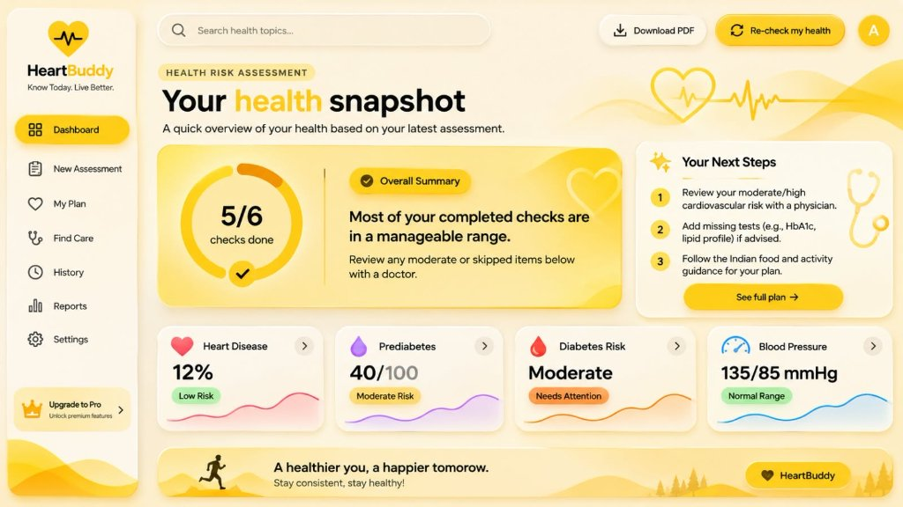

# HealthBuddy 🩺

> **Clinical Decision-Support & Risk Stratification Platform for South Asian Cardiometabolic Health**
> An educational, full-stack digital health application combining deterministic clinical calculators, machine learning risk estimations, verified healthcare care options, and physician-reviewed care guidance.



---

## 📑 Table of Contents
1. [Overview & Healthcare Objectives](#-overview--healthcare-objectives)
2. [End-to-End System Flow](#-end-to-end-system-flow)
3. [Clinical Safety Principles & Red-Flag Triage](#-clinical-safety-principles--red-flag-triage)
4. [Phase A: 3-Step Input Wizard](#-phase-a-3-step-input-wizard)
5. [Phase B: Results & Care Guidance Dashboard](#-phase-b-results--care-guidance-dashboard)
6. [Clinical Calculators & Algorithms (Formulas & Cutoffs)](#-clinical-calculators--algorithms-formulas--cutoffs)
   - [Anthropometry & South Asian BMI](#1-anthropometry--south-asian-bmi)
   - [Blood Pressure Staging (JNC7 / ACC / AHA)](#2-blood-pressure-staging-jnc7--acc--aha)
   - [Glycemic Status & IFCC / NGSP Auto-Conversion](#3-glycemic-status--ifcc--ngsp-auto-conversion)
   - [Indian Diabetes Risk Score (IDRS)](#4-indian-diabetes-risk-score-idrs)
   - [WHO South Asia 10-Year CVD Risk](#5-who-south-asia-10-year-cvd-risk)
   - [CKD-EPI 2021 Race-Free eGFR + ACR Staging](#6-ckd-epi-2021-race-free-egfr--acr-staging)
   - [Harmonized South Asian Metabolic Syndrome](#7-harmonized-south-asian-metabolic-syndrome)
7. [Machine Learning Engine & Safeguards](#-machine-learning-engine--safeguards)
8. [Care Guidance & Verified Care Routing](#-care-guidance--verified-care-routing)
9. [ReportLab PDF Export Engine](#-reportlab-pdf-export-engine)
10. [Frontend Design System & Accessibility](#-frontend-design-system--accessibility)
11. [System Architecture & Repository Structure](#-system-architecture--repository-structure)
12. [API Reference & Data Contracts](#-api-reference--data-contracts)
13. [Installation & Operational Guide](#-installation--operational-guide)
14. [Regulatory Disclaimer](#-regulatory-disclaimer)

---

## 🌟 Overview & Healthcare Objectives

HealthBuddy was engineered specifically to address the **"Asian Indian Phenotype"**—a well-documented clinical profile marked by:
- Higher body fat percentage and visceral abdominal adiposity at relatively lower body mass indices (BMI).
- Heightened insulin resistance leading to early onset of Type 2 Diabetes (often presenting 10–15 years earlier than in Western populations).
- Accelerated and premature Coronary Artery Disease (CAD).
- High prevalence of atherogenic dyslipidemia (elevated triglycerides and low HDL cholesterol).

HealthBuddy bridges the early-screening gap through a fast (under 3 minutes), privacy-first, zero-barrier platform that provides instant risk stratification, actionable lifestyle precautions, and verified healthcare provider routing.

---

## 🔄 End-to-End System Flow

```
                      +-----------------------------+
                      |   User Opens HealthBuddy    |
                      +-----------------------------+
                                     |
                                     v
                      +-----------------------------+
                      | Phase A: 3-Step Wizard      |
                      | 1. Basics & Safety Red Flags|
                      | 2. Lifestyle & Family Hx    |
                      | 3. Optional Lab Biomarkers  |
                      +-----------------------------+
                                     |
                       [ User Clicks "Analyze Risk" ]
                                     |
                                     v
                       POST /api/v1/assess (FastAPI)
                                     |
                 < Did any Red-Flag Safety Rule trigger? >
                       /                           \
                     YES                            NO
                     /                                \
                    v                                  v
+------------------------------------+   +------------------------------------+
| Server-Side Emergency Override     |   | Deterministic Calculators Engine:  |
| - Pipeline terminates immediately  |   | 1. South Asian Anthropometry (BMI) |
| - No scores or advice generated    |   | 2. Blood Pressure (JNC7 / AHA)     |
| - Returns: emergency dispatch      |   | 3. Glycemic Staging (FPG / HbA1c)  |
|   (112 / 108 / 911) & trauma units |   | 4. IDRS (Dr. V. Mohan / MDRF)      |
+------------------------------------+   | 5. WHO South Asia 10-Yr CVD Risk   |
                    |                    | 6. CKD-EPI 2021 Race-Free eGFR+ACR |
                    v                    | 7. South Asian Metabolic Syndrome  |
+------------------------------------+   +------------------------------------+
| Full-Screen Emergency View Rendered|                     |
| - Single-tap phone call buttons    |                     v
| - Nearest 24/7 emergency hospitals |   +------------------------------------+
+------------------------------------+   | Machine Learning Inference:        |
                                         | - Validates feature availability   |
                                         | - Missing data -> "needs_more_info"|
                                         | - Calibrated coarse risk bands     |
                                         +------------------------------------+
                                                           |
                                                           v
                                         +------------------------------------+
                                         | Care Routing & Recommendations:   |
                                         | - Urgency rating (Immediate/Routine|
                                         | - Top 3 "What To Do First" steps   |
                                         | - Matched verified local hospitals |
                                         | - Diet, Exercise, Follow-up dates  |
                                         +------------------------------------+
                                                           |
                                                           v
                                         +------------------------------------+
                                         | Phase B: Results Dashboard         |
                                         | - Warm organic ambient canvas      |
                                         | - Hero Summary Ring (5/6 done)     |
                                         | - 4 Primary Sparkline Cards        |
                                         | - Care options & Leaflet map       |
                                         | - Food Precautions: Eat vs. Avoid  |
                                         | - Activity targets & Clearance     |
                                         | - ReportLab PDF Download           |
                                         +------------------------------------+
```

---

## 🛡️ Clinical Safety Principles & Red-Flag Triage

HealthBuddy is built with clinical decision-support safety boundaries:

1. **Server-Side Red-Flag Gate**:
   - The server validates four acute clinical red flags before executing any scoring algorithms:
     - Severe substernal chest pain radiating to arm, neck, jaw, or back.
     - Sudden onset of stroke symptoms (facial droop, arm weakness, speech slurring / aphasia).
     - Acute severe gastrointestinal bleeding (hematemesis or melena/black tarry stools).
     - Symptomatic severe hyperglycemia accompanied by altered consciousness or Kussmaul breathing.
   - **Enforcement**: If any red flag is active, `/api/v1/assess` returns only `{ emergency: { ... } }`. Scoring calculations, diet tips, and exercise guidance are completely suppressed.
2. **Medical Language Governance**:
   - Uses *"estimated risk band"* (never *"chance you have the disease"* or *"your diagnosis"*).
   - Uses *"care guidance"* (never *"cure"* or *"medical treatment"*).
   - Uses *"recommended care options"* (never *"best hospital"* or *"endorsed doctor"*).
   - **Zero medication recommendations**: No drug names, dosing schedules, or titration advice appear anywhere in the software.
3. **Physician Attribution & Production Guard**:
   - Every guidance card includes:
     - `Based on: {Clinical Guideline / Medical Society}` (e.g., ICMR, WHO, KDIGO).
     - `Reviewed by: {Physician Name & Credentials}` (e.g., Dr. A. Sharma, MD Internal Medicine).
     - Unreviewed or pending plans show a `Pending doctor review` badge.
4. **Transparent Separation of Rules and ML**:
   - Rule-based clinical scores and ML model predictions are never blended or averaged together. They are displayed as distinct modules with independent confidence indicators.
5. **No Silent Imputation**:
   - If laboratory tests (e.g., creatinine, HbA1c) are omitted, modules return `status: "skipped"` or `"needs_more_info"`. The system never imputes or guesses missing medical values.

---

## 📝 Phase A: 3-Step Input Wizard

The input wizard guides the user through three organized steps:

### Step 1: Basics & Safety
- **Red-Flag Screening**: 4-point triage checklist.
- **Demographics & Physical Vitals**: Age, Biological Sex, Height (cm), Weight (kg).
- **Live BMI Feedback**: BMI is auto-calculated with South Asian cutoffs as the user types.
- **Cardiovascular Vitals**: Waist Circumference (cm), Systolic Blood Pressure (SBP, mmHg), Diastolic Blood Pressure (DBP, mmHg), Resting Heart Rate (bpm).
- **Location**: City or PIN code (optional, used for local hospital matching).

### Step 2: Lifestyle & Family History
- **Tobacco Use**: Non-smoker, Ex-smoker, Current smoker.
- **Alcohol Intake**: Drinks consumed per week.
- **Physical Activity**: Vigorous, Moderate, Mild, or Sedentary (with concrete daily examples).
- **Sleep & Sedentary Time**: Hours of sleep per night, daily sitting hours.
- **Family History**: Type 2 Diabetes (None, One parent, Both parents) and early Coronary Heart Disease.

### Step 3: Optional Lab Biomarkers
- **"Skip, I don't have lab reports"**: Prominent button allowing immediate analysis without laboratory data.
- **Glycemic Markers**: Fasting Plasma Glucose (FPG), HbA1c (with automatic IFCC to NGSP detection), 2-hour Oral Glucose Tolerance Test (OGTT).
- **Lipid Panel**: Total Cholesterol, LDL, HDL, Triglycerides.
- **Renal Panel**: Serum Creatinine (auto-calculates CKD-EPI 2021 eGFR), Urine Albumin-to-Creatinine Ratio (ACR).
- **Consent Checkbox**: *"Save my results to History"* (defaults to unchecked; patient health data is processed in-memory unless explicit consent is granted).

---

## 📊 Phase B: Results & Care Guidance Dashboard

The results screen features a sticky section navigation bar (`Risk`, `Care`, `Food`, `Exercise`, `Follow-up`):

### 1. Hero Summary Card (Yellow Gradient)
- **SVG Circular Progress Ring**: Displays the completed clinical checks ratio (e.g., `5/6 checks done`) with a completion badge.
- **Overall Clinical Synthesis**: Synthesizes whether completed metrics are in manageable ranges or need medical follow-up.

### 2. "Your Next Steps" Card (White Soft Shadow)
- Illustrated with a custom stethoscope outline vector.
- Renders the **Top 3 Clinical Priorities** derived from the user's highest risk tier (e.g., *"1. Review cardiovascular risk with a physician"*, *"2. Add missing creatinine lab"*, *"3. Follow low-sodium food guidance"*).
- One-click `"See full plan ->"` action button.

### 3. Primary Condition Cards (4 Sparkline Cards)
Matched to the design system:
- **Heart Disease**: Pink heart icon, 10-year WHO CVD score, `Low Risk` green chip, smooth pink SVG wave.
- **Prediabetes**: Purple droplet icon, IDRS screening score out of 100, `Moderate Risk` amber chip, smooth purple SVG wave.
- **Diabetes Risk**: Red droplet icon, metabolic risk indicator, `Needs Attention` orange chip, smooth orange SVG wave.
- **Blood Pressure**: Cyan-blue gauge icon, BP reading (e.g., `135/85 mmHg`), `Normal Range` green chip, smooth blue SVG wave.
- *All cards feature a top-right chevron button `>` to expand into the care plan, and skipped cards provide an `"Add lab values"` button.*

### 4. Secondary Clinical Markers Row
- **BMI (Indian Cutoffs)**: Value with overweight/obese categorization.
- **Metabolic Syndrome**: Harmonized South Asian criteria count (out of 5).
- **Kidney Health**: eGFR (CKD-EPI 2021) and ACR damage staging.

### 5. Care Options & Facility Finder
- Matches verified public and private hospitals within the user's geographic area.
- Displays emergency capability badges (`24x7 Emergency Ready`), verified checkmarks, specialty focus (Cardiology, Diabetology, Nephrology), and telephone contacts.
- Includes an interactive Leaflet map with custom hospital pins.

### 6. Precautions: Food to Eat & Avoid
- Condition-specific guidance tabs tailored to Indian cuisine:
  - **Eat More**: Whole millets (bajra, jowar, ragi), sprouted pulses, bitter gourd, methi, flaxseeds, high-fiber seasonal vegetables.
  - **Avoid**: Maida, deep-fried snacks (samosas, pakoras), sweets/mithai, high-sodium pickles, sweetened carbonated drinks, saturated oils.

### 7. Exercise Guidance
- Activity targets aligned with WHO/ICMR standards (e.g., 150 minutes of moderate activity per week).
- High-risk cardiovascular or hypertension assessments display a bold red warning:
  > *"Get medical clearance from a physician before initiating a new exercise regimen."*

### 8. Follow-up Timeline & Vector PDF Download
- Generates precise clinical re-screening intervals (3, 6, or 12 months based on condition tier).
- One-click **Download PDF** generates a formatted medical report.

---

## 🧮 Clinical Calculators & Algorithms (Formulas & Cutoffs)

### 1. Anthropometry & South Asian BMI
$$\text{BMI} = \frac{\text{Weight (kg)}}{(\text{Height (m)})^2}$$
- **Classification Cutoffs**:
  - Underweight: $< 18.5 \text{ kg/m}^2$
  - Normal Weight: $18.5 – 22.9 \text{ kg/m}^2$
  - Overweight: $23.0 – 24.9 \text{ kg/m}^2$
  - Obese: $\ge 25.0 \text{ kg/m}^2$ (compared to Western threshold of $\ge 30 \text{ kg/m}^2$)
- **Central Adiposity (Waist Circumference)**:
  - Men: Normal $< 90\text{ cm}$, Elevated $\ge 90\text{ cm}$
  - Women: Normal $< 80\text{ cm}$, Elevated $\ge 80\text{ cm}$

### 2. Blood Pressure Staging (JNC7 / ACC / AHA)
- **Normal**: $\text{SBP} < 120\text{ mmHg}$ and $\text{DBP} < 80\text{ mmHg}$
- **Elevated**: $\text{SBP } 120–129\text{ mmHg}$ and $\text{DBP} < 80\text{ mmHg}$
- **Stage 1 Hypertension**: $\text{SBP } 130–139\text{ mmHg}$ or $\text{DBP } 80–89\text{ mmHg}$
- **Stage 2 Hypertension**: $\text{SBP } \ge 140\text{ mmHg}$ or $\text{DBP } \ge 90\text{ mmHg}$
- **Hypertensive Crisis**: $\text{SBP } > 180\text{ mmHg}$ or $\text{DBP } > 120\text{ mmHg}$

### 3. Glycemic Status & IFCC / NGSP Auto-Conversion
- **Automatic IFCC ($\text{mmol/mol}$) to NGSP ($\%$) formula**:
  $$\text{HbA1c}_{\%} = (\text{HbA1c}_{\text{mmol/mol}} \times 0.09148) + 2.152$$
- **Staging**:
  - *Normal*: FPG $<100\text{ mg/dL}$, HbA1c $<5.7\%$, 2h OGTT $<140\text{ mg/dL}$
  - *Prediabetes*: FPG $100–125\text{ mg/dL}$, HbA1c $5.7–6.4\%$, 2h OGTT $140–199\text{ mg/dL}$
  - *Diabetes*: FPG $\ge 126\text{ mg/dL}$, HbA1c $\ge 6.5\%$, 2h OGTT $\ge 200\text{ mg/dL}$

### 4. Indian Diabetes Risk Score (IDRS)
- Validated by Dr. V. Mohan / Madras Diabetes Research Foundation (MDRF):
  - **Age**: $<35$ yrs ($+0$), $35–49$ yrs ($+20$), $\ge 50$ yrs ($+30$)
  - **Waist**: Female $<80$ / Male $<90\text{ cm}$ ($+0$); Female $80–89$ / Male $90–99\text{ cm}$ ($+10$); Female $\ge 90$ / Male $\ge 100\text{ cm}$ ($+20$)
  - **Activity**: Vigorous ($+0$), Moderate ($+10$), Mild ($+20$), Sedentary ($+30$)
  - **Family History of Diabetes**: Neither parent ($+0$), One parent ($+10$), Both parents ($+20$)
- **Risk Tiers**:
  - $< 30$: Low Risk
  - $30 – 59$: Moderate Risk
  - $\ge 60$: High Risk

### 5. WHO South Asia 10-Year CVD Risk
- Validated for ages **40 to 74**. (Returns `status: "skipped"` for ages outside this range).
- Evaluates Age, Sex, Smoking Status, SBP, and optional Cholesterol or BMI.
- Risk Bands: Low ($<10\%$), Moderate ($10–19\%$), High ($20–29\%$), Very High ($\ge 30\%$).

### 6. CKD-EPI 2021 Race-Free eGFR + ACR Staging
- **KDIGO 2024 race-free formula ($\text{mL/min}/1.73\text{m}^2$)**:
  $$\text{eGFR} = 142 \times \min\left(\frac{S_{\text{cr}}}{\kappa}, 1\right)^\alpha \times \max\left(\frac{S_{\text{cr}}}{\kappa}, 1\right)^{-1.200} \times 0.9938^{\text{Age}} \times [1.012 \text{ if female}]$$
  *(Females: $\kappa = 0.7, \alpha = -0.241$; Males: $\kappa = 0.9, \alpha = -0.302$; $S_{\text{cr}}$ = Serum Creatinine in $\text{mg/dL}$)*
- **Staging Grid**:
  - G1 ($\ge 90$), G2 ($60–89$), G3a ($45–59$), G3b ($30–44$), G4 ($15–29$), G5 ($<15$)
  - Urine ACR: A1 ($<30\text{ mg/g}$), A2 ($30–300\text{ mg/g}$), A3 ($>300\text{ mg/g}$)

### 7. Harmonized South Asian Metabolic Syndrome
Requires any **3 of 5** components:
1. Central Adiposity: Waist $\ge 90\text{ cm}$ (Men), $\ge 80\text{ cm}$ (Women).
2. Hypertriglyceridemia: Triglycerides $\ge 150\text{ mg/dL}$.
3. Low HDL: HDL $< 40\text{ mg/dL}$ (Men), $< 50\text{ mg/dL}$ (Women).
4. Elevated BP: SBP $\ge 130\text{ mmHg}$ or DBP $\ge 85\text{ mmHg}$.
5. Elevated Fasting Glucose: Glucose $\ge 100\text{ mg/dL}$.

---

## 🤖 Machine Learning Engine & Safeguards

- **No Silent Guessing**: The ML predictor checks input feature vectors before inference. If required features are absent (e.g., voice acoustic parameters or liver enzyme panels), it returns `status: "needs_more_info"`.
- **Calibrated Coarse Bands**: Raw probabilities are not displayed to patients. Outputs are mapped to coarse, clinically verified risk bands:
  - Low ($< 10\%$), Moderate ($10–30\%$), High ($> 30\%$).
- **Secondary Opinion Modules**:
  1. *Parkinson's Disease Voice Biomarkers*: Screens 22 phonation parameters (Jitter, Shimmer, NHR, HNR, RPDE).
  2. *Liver Function Screening*: Evaluates 10 clinical and biochemical markers (Bilirubin, ALP, ALT, AST, Albumin/Globulin ratio).

---

## 🏥 Care Guidance & Verified Care Routing

The care matcher evaluates geography and clinical specialty:
- Computes condition urgency (`immediate`, `within_2_weeks`, `routine`).
- Filters verified facilities matching the highest risk specialty (Cardiology, Endocrinology, Diabetology, Nephrology).
- Displays verified badges, 24x7 emergency capability, distance metrics, and telephone numbers.
- Embeds an interactive Leaflet map for direct visual navigation.

---

## 📄 ReportLab PDF Export Engine

The backend generates a two-page clinical PDF report ready for doctor review:
- **Header**: Patient identifier, assessment date, educational disclaimer.
- **Summary Metrics Table**: Anthropometry, blood pressure, glycemic markers, renal metrics.
- **Risk Stratifications**: WHO 10-year CVD percentage, IDRS diabetes score, eGFR staging.
- **Doctor-Reviewed Action Plan**: Dietary precautions, physical activity targets, follow-up timeline.
- **Clinician Signature Block**: Dedicated section for physician notes, verification stamp, and signature.

---

## 🎨 Frontend Design System & Accessibility

- **Color Tokens**:
  - `bg-warm-canvas`: Warm organic cream `#FFF8E3` with radial ambient gradients (`rgba(255, 200, 61, 0.42)` and `rgba(255, 205, 75, 0.35)`).
  - `hb-amber`: `#FFC83D` (Primary button and active tabs).
  - `hb-brown`: `#2B2208` (Primary ink; high contrast ratio $> 11:1$ on cream).
  - `hb-muted`: `#6B5B2E` / `#7C6C3E` (Secondary typography).
- **Cards & Shadows**: Pillowy `rounded-[22px]` to `rounded-[24px]` radius with warm ambient shadows (`0 10px 30px -10px rgba(43, 34, 8, 0.08)`).
- **Accessibility (WCAG AA)**:
  - 44px minimum touch targets on all interactive elements.
  - Visible keyboard focus rings (`ring-2 ring-amber-500 ring-offset-2`).
  - Full keyboard ARIA navigation (`ArrowRight`, `ArrowLeft`, `Home`, `End` on plan tabs).
  - Never relies on color alone (always pairs color with text chips and icons).
  - Reduced-motion queries respected (`prefers-reduced-motion`).
- **Bilingual Localization**:
  - Full translation coverage in English and Hindi (हिंदी).
  - Dynamic number and date formatting via `Intl` (`en-IN` and `hi-IN`).
  - Typography: Plus Jakarta Sans with Noto Sans Devanagari fallback.

---

## 🏗 System Architecture & Repository Structure

```
HealthBuddy/
├── backend/
│   ├── app/
│   │   ├── api/                     # FastAPI route handlers
│   │   │   ├── assess.py            # POST /api/v1/assess (Unified screening)
│   │   │   ├── care.py              # POST /api/v1/care/recommend (Hospital routing)
│   │   │   ├── reports.py           # POST /api/v1/reports/pdf (ReportLab PDF exporter)
│   │   │   ├── history.py           # User assessment logs
│   │   │   ├── models.py            # ML model metadata & benchmark inspection
│   │   │   └── auth.py              # Authentication & session endpoints
│   │   ├── calculators/             # Deterministic clinical algorithms
│   │   │   ├── anthropometry.py     # South Asian BMI & waist cutoffs
│   │   │   ├── bp.py                # Blood pressure staging
│   │   │   ├── glucose.py           # Glycemic status & IFCC/NGSP conversion
│   │   │   ├── idrs.py              # Indian Diabetes Risk Score
│   │   │   ├── who_cvd.py           # WHO South Asia 10-year CVD risk
│   │   │   ├── kidney.py            # CKD-EPI 2021 race-free eGFR & ACR
│   │   │   └── metabolic.py         # Harmonized South Asian MetSyn
│   │   ├── services/
│   │   │   ├── safety.py            # Red-flag emergency override engine
│   │   │   ├── care_matcher.py      # Hospital and specialist routing
│   │   │   ├── pdf_report.py        # ReportLab vector canvas renderer
│   │   │   ├── predictor.py         # ML feature inspector & inference
│   │   │   └── recommend/           # Doctor-reviewed plan loader
│   │   │       └── content/         # Condition-specific JSON care plans
│   │   ├── database/                # SQLAlchemy models & SQLite session
│   │   └── schemas/                 # Pydantic v2 validation contracts
│   └── tests/                       # Pytest test suite (16 tests)
│
├── frontend/
│   ├── app/
│   │   ├── globals.css              # Warm canvas theme, ambient gradients
│   │   ├── layout.tsx               # Root layout & meta tags
│   │   └── page.tsx                 # Core Dashboard, Hero, Cards, & Section tabs
│   ├── components/
│   │   ├── banners/
│   │   │   └── DisclaimerBanner.tsx # Non-dismissible clinical disclaimer
│   │   ├── Care/
│   │   │   └── HospitalList.tsx     # Hospital cards with verified badges
│   │   ├── charts/
│   │   │   └── RiskRing.tsx         # Circular SVG progress ring
│   │   ├── map/
│   │   │   └── HospitalMap.tsx      # Leaflet interactive map
│   │   ├── Plan/
│   │   │   └── PlanTabs.tsx         # Accessible ARIA care plan tabs
│   │   ├── Results/
│   │   │   └── ConditionCard.tsx    # Sparkline cards with status chips
│   │   └── Wizard/
│   │       └── AssessmentWizard.tsx # 3-step progressive input wizard
│   ├── data/                        # Localized care plans (en/hi) & hospitals
│   ├── locales/                     # UI dictionaries (en.json, hi.json)
│   └── tests/                       # Vitest component test suite (5 tests)
│
├── healthbuddy_snapshot.jpg         # Visual dashboard reference screenshot
├── HealthBuddy.md                   # Complete master clinical & technical spec
└── README.md                        # Comprehensive system documentation
```

---

## 🔌 API Reference & Data Contracts

### POST /api/v1/assess
Unified endpoint executing validation, safety triage, clinical calculators, ML screening, and care recommendations in a single atomic pipeline.

#### Request Body (Sample)
```json
{
  "red_flags": {
    "chest_pain": false,
    "stroke_symptoms": false,
    "severe_bleeding": false,
    "high_sugar_symptoms": false
  },
  "basics": {
    "age": 48,
    "sex": "male",
    "height_cm": 172.0,
    "weight_kg": 73.8,
    "waist_cm": 92.0,
    "systolic_bp": 135,
    "diastolic_bp": 85,
    "resting_heart_rate": 74,
    "city": "New Delhi"
  },
  "lifestyle": {
    "smoking": "non_smoker",
    "alcohol_drinks_per_week": 0,
    "physical_activity": "moderate",
    "sitting_hours_per_day": 7,
    "sleep_hours_per_night": 7,
    "family_history_diabetes": "one_parent",
    "family_history_heart_disease": true
  },
  "labs": {
    "fasting_glucose_mg_dl": 108.0,
    "hba1c_pct": 5.8,
    "cholesterol_total_mg_dl": 195.0,
    "creatinine_mg_dl": null,
    "urine_acr_mg_g": null
  },
  "consent_data_storage": true
}
```

#### Response (Standard Output)
```json
{
  "emergency": null,
  "urgency": "within_2_weeks",
  "what_to_do_first": [
    "Review your moderate cardiovascular risk with a physician.",
    "Add missing kidney labs (creatinine & urine ACR) if advised.",
    "Follow the Indian food and activity guidance for your plan."
  ],
  "modules": [
    {
      "module": "heart_who_cvd",
      "status": "computed",
      "score": 12.0,
      "category": "low",
      "unit": "%",
      "method": "WHO South Asia Non-Lab Chart (includes Stroke)",
      "factors": ["SBP 135 mmHg", "Age 48 yrs"],
      "kind": "rule"
    },
    {
      "module": "diabetes_idrs",
      "status": "computed",
      "score": 40,
      "category": "moderate",
      "unit": "/100",
      "method": "IDRS (<30 Low, 30-59 Moderate, >=60 High)",
      "factors": ["Age 35-49 (+20)", "Waist 92 cm (+10)", "Moderate activity (+10)"],
      "kind": "rule"
    },
    {
      "module": "kidney_ckd_epi",
      "status": "skipped",
      "skip_reason": "Creatinine and urine ACR not entered yet.",
      "score": null,
      "category": null,
      "unit": "mL/min/1.73m2",
      "method": "CKD-EPI 2021 (Race-Free)",
      "factors": [],
      "kind": "rule"
    }
  ],
  "care": {
    "specialist_types": ["Cardiologist", "Diabetologist"],
    "matched_hospitals": [...]
  },
  "followups": [
    { "condition": "heart", "tier": "low", "due_date": "2027-11-25" },
    { "condition": "diabetes", "tier": "moderate", "due_date": "2027-05-25" }
  ]
}
```

#### Response (Red-Flag Emergency Short-Circuit)
```json
{
  "emergency": {
    "status": "emergency_detected",
    "triggered_rules": ["Severe chest pain"],
    "emergency_numbers": { "India": "112 / 108", "US": "911" }
  }
}
```

---

## 🚀 Installation & Operational Guide

### Prerequisites
- Python 3.10+
- Node.js 18+ and npm
- Linux, macOS, or Windows WSL

### 1. Backend Service
```bash
cd backend
python3 -m venv .venv
source .venv/bin/activate
pip install -r requirements.txt
uvicorn app.main:app --host 0.0.0.0 --port 8000 --reload
```
- Swagger API Docs: `http://localhost:8000/docs`
- Healthcheck: `http://localhost:8000/api/v1/health`

### 2. Frontend Client
```bash
cd frontend
npm install
npm run build
npm start -- -p 3006
```
- Open [http://localhost:3006](http://localhost:3006) in your browser.

### 3. Train ML #3 Personalized Recommender (Optional, artifacts committed)
```bash
# From repo root:
backend/.venv/bin/python -m backend.ml.reco.train
```
Generates `backend/artifacts/reco_model.joblib`, `reco_eval.json`, and `reco_meta.json` (see [docs/RECO_MODEL_CARD.md](docs/RECO_MODEL_CARD.md)).

### 4. Test Suites
```bash
# Run Backend Pytest Suite
cd backend && PYTHONPATH=. .venv/bin/pytest -v

# Run Frontend TypeScript & Vitest Suite
cd frontend && npx tsc --noEmit && npm test
```

---

## ⚖️ Regulatory Disclaimer

**Educational screening tool, not a medical device.** HealthBuddy does not diagnose disease, formulate medical diagnoses, or prescribe pharmacotherapy. It provides educational risk estimations derived from published clinical population studies. Users must consult licensed physicians for clinical interpretation and management decisions. In the event of acute chest discomfort, neurological symptoms, or severe shortness of breath, call emergency services (112 / 108) immediately.
